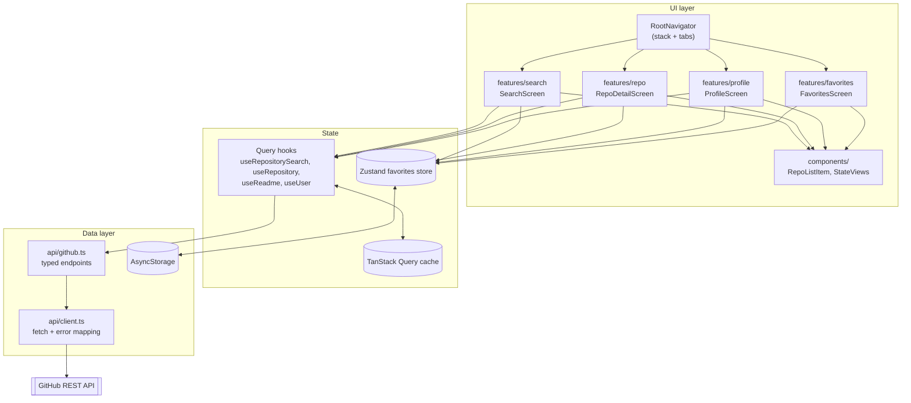

# GitHub Explorer (React Native)

[](https://github.com/trsimanto/react-native-github-explorer/actions/workflows/ci.yml)


A fast, offline-friendly GitHub browser for iOS and Android, built with Expo and TypeScript.
Search millions of repositories, read READMEs, look up maintainers and keep a list of favorites,
all through GitHub's public REST API with no account or token required.

The project is intentionally small but production-shaped: a typed API layer, server-state caching
with TanStack Query, a persisted client store, feature-based modules and a test suite that runs on
every push.

## Features

- **Repository search** with a 400 ms debounce, infinite scroll and sorting by stars or last update
- **Repository detail**: description, stars, forks, open issues, language, license, topics and the
  README rendered as Markdown (relative image and doc links are resolved against the repo)
- **Owner profile**: avatar, bio, follower counts, links and recently pushed repositories
- **Favorites** stored on the device with Zustand + AsyncStorage, available offline
- **Pull-to-refresh** on every remote list and detail screen
- **Loading, empty and error states** with retry everywhere
- **Rate-limit aware**: GitHub's 403/429 responses are detected and shown with the exact reset time;
  rate-limited and 4xx requests are never retried automatically
- **Dark mode** that follows the system setting, including navigation chrome
- **Accessibility**: labelled buttons, roles and selected states for screen readers

## Tech stack

| Area         | Choice                                                                 |
| ------------ | ---------------------------------------------------------------------- |
| Runtime      | Expo SDK 58 (managed workflow), React Native 0.88, React 19            |
| Language     | TypeScript (`strict`, `noUncheckedIndexedAccess`)                      |
| Navigation   | React Navigation 7: native stack + bottom tabs, fully typed params     |
| Server state | TanStack Query v5 (`useInfiniteQuery`, caching, retry policy, refetch) |
| Client state | Zustand 5 with `persist` middleware on AsyncStorage                    |
| Networking   | Typed `fetch` client with domain errors (`RateLimitError`, etc.)       |
| Markdown     | `react-native-markdown-display`, themed for light and dark             |
| Testing      | Jest 30 (`jest-expo`) + React Native Testing Library 14                |
| Quality      | ESLint 9 (`eslint-config-expo`) + Prettier, `tsc --noEmit`             |
| CI           | GitHub Actions: install, lint, typecheck, test with coverage           |

## Architecture



**Key decisions**

- **Server state and client state are kept apart.** Anything that comes from GitHub lives in the
  React Query cache; the only client-owned state is the list of favorites, which lives in a small
  Zustand store and is persisted as slim `RepoSummary` objects.
- **Errors are typed at the edge.** `api/client.ts` turns HTTP responses into `GitHubApiError`,
  `RateLimitError` (with `resetAt`) or `NetworkError`. Screens only decide how to present them,
  through a single `ErrorState` component.
- **Retry policy follows the API's rules.** A rate-limited request will keep failing until the reset
  time, so `shouldRetry` skips rate limits and 4xx responses and retries transient failures twice.
- **Infinite scroll respects search limits.** The search API returns at most 1,000 results, so
  `getNextSearchPage` stops paging there and de-duplicates items that shift between pages.
- **App focus drives refetching.** React Query's `focusManager` is wired to `AppState`, so stale data
  refreshes when the app returns to the foreground.

## Project structure

```text
src/
├── App.tsx                     # Providers: SafeArea, QueryClient, Theme
├── api/
│   ├── client.ts               # fetch wrapper, URL builder, rate-limit parsing
│   ├── errors.ts               # GitHubApiError, RateLimitError, NetworkError
│   ├── github.ts               # typed endpoints (search, repo, readme, user)
│   ├── queryKeys.ts            # query key factory
│   └── types.ts                # API models + RepoSummary
├── components/                 # RepoListItem, StateViews, Chip, Stat, icons
├── features/
│   ├── search/                 # SearchScreen, SearchBar, SortToggle, useRepositorySearch
│   ├── repo/                   # RepoDetailScreen, ReadmeView, query hooks
│   ├── profile/                # ProfileScreen, ProfileHeader, query hooks
│   └── favorites/              # FavoritesScreen, favoritesStore (Zustand + persist)
├── lib/                        # formatting, debounce hook, README link resolver, QueryClient
├── navigation/                 # RootNavigator, typed route params
└── theme/                      # light/dark palettes, spacing, ThemeProvider
test/
├── setup.ts                    # AsyncStorage mock
└── utils.tsx                   # QueryClient wrapper, fixtures, Response helpers
```

## Running the app

Requirements: Node.js 20.19+ (22 LTS recommended) and the **Expo Go** app on your phone
([iOS](https://apps.apple.com/app/expo-go/id982107779) /
[Android](https://play.google.com/store/apps/details?id=host.exp.exponent)).
Expo Go needs to support SDK 58.

```bash
git clone https://github.com/trsimanto/react-native-github-explorer.git
cd react-native-github-explorer
npm ci
npx expo start
```

Scan the QR code with the Camera app (iOS) or from inside Expo Go (Android). Your phone and computer
must be on the same network; if they are not, use `npx expo start --tunnel`.

Emulators work too: press `a` for an Android emulator or `i` for the iOS simulator in the Expo CLI.

> The app calls the GitHub API without authentication, which GitHub limits to 60 requests per hour and
> 10 search requests per minute per IP address. When you hit the limit the app tells you when it
> resets.

## Testing and quality checks

```bash
npm test              # Jest + React Native Testing Library
npm run test:coverage # with coverage report
npm run lint          # ESLint + Prettier
npm run typecheck     # tsc --noEmit
```

What is covered:

| Suite                          | Focus                                                                                                           |
| ------------------------------ | --------------------------------------------------------------------------------------------------------------- |
| `api/client.test.ts`           | URL building, headers, primary/secondary rate limits, 403 vs 404, network failures, raw README media type       |
| `favoritesStore.test.ts`       | add/remove/toggle/clear, de-duplication, persistence and rehydration                                            |
| `useRepositorySearch.test.tsx` | disabled on empty query, pagination, de-duplication, rate-limit error, refetch on sort change, 1,000 result cap |
| `RepoListItem.test.tsx`        | rendering, press handling, favorite toggle isolation, accessibility labels                                      |
| `StateViews.test.tsx`          | rate-limit, offline, not-found and generic errors; retry button                                                 |
| `format.test.ts`               | number/date formatting, README link resolution, retry policy                                                    |

The same checks run in [GitHub Actions](.github/workflows/ci.yml) on every push and pull request.

## Roadmap

- [ ] Optional personal access token (stored in `expo-secure-store`) for higher rate limits
- [ ] Search filters: language, minimum stars, created date
- [ ] Persist the React Query cache for a fuller offline experience
- [ ] Repository contributors, releases and issues tabs
- [ ] Deep links (`githubexplorer://repo/owner/name`)
- [ ] Syntax highlighting for README code blocks
- [ ] End-to-end tests with Maestro
- [ ] EAS Build profiles and store-ready app icons

## Author

**Towhidur Rahman** — Lead Mobile Developer · [linkedin.com/in/trsimanto](https://www.linkedin.com/in/trsimanto)

## License

[MIT](LICENSE) © 2026 Towhidur Rahman
